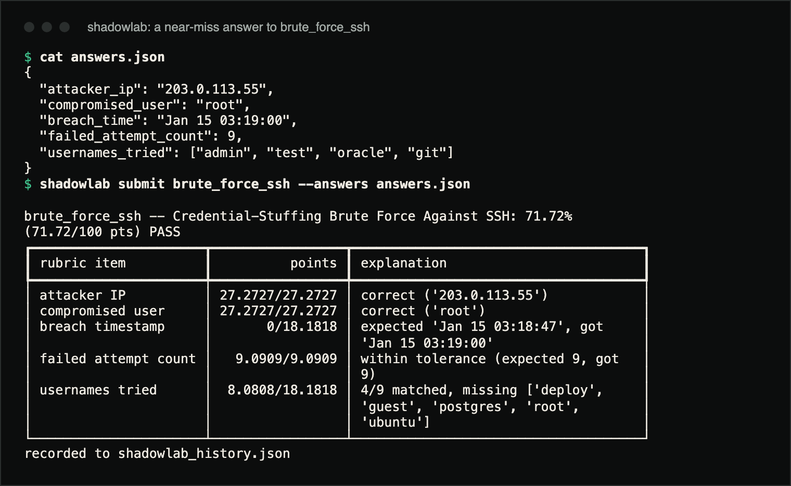
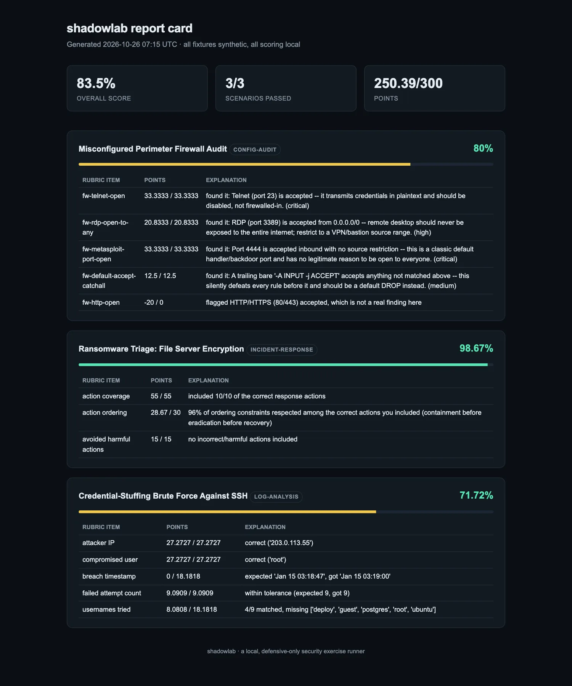

# shadowlab

A local, offline exercise runner for defensive security practice: log
analysis, config audit and incident response scenarios, each graded with
partial credit and a plain-English explanation for every point earned or lost.
All fixtures are synthetic. There are no network calls, no exploit code and no
destructive techniques in this repository. It is a blue-team teaching lab, not
a red-team tool.

"Sandboxed" here describes how it is built, not an OS-level sandbox:
shadowlab never executes anything you submit (answers are JSON data compared
against computed ground truth), opens no network connections, starts no
processes, reads only its own bundled fixtures plus the answers and history
files you name, and writes only the history and report files. A test
(`test_no_command_opens_a_network_connection_or_runs_a_process`) runs every
command against every scenario with sockets and process creation disabled and
checks which files were written.

**Status:** version 0.1.0, installed from a clone (not on PyPI). Seven bundled
scenarios.

## Demo

Real captures from a clone, using a deliberately imperfect answer file.



A near-miss answer to `brute_force_ssh`: right IP and account, breach time off
by 13 seconds, four of the nine usernames:

```console
$ cat answers.json
{
  "attacker_ip": "203.0.113.55",
  "compromised_user": "root",
  "breach_time": "Jan 15 03:19:00",
  "failed_attempt_count": 9,
  "usernames_tried": ["admin", "test", "oracle", "git"]
}
$ shadowlab submit brute_force_ssh --answers answers.json

brute_force_ssh -- Credential-Stuffing Brute Force Against SSH: 71.72% 
(71.72/100 pts) PASS
┏━━━━━━━━━━━━━━━━━━━━━━┳━━━━━━━━━━━━━━━━━┳━━━━━━━━━━━━━━━━━━━━━━━━━━━━━━━━━━━━━┓
┃ rubric item          ┃          points ┃ explanation                         ┃
┡━━━━━━━━━━━━━━━━━━━━━━╇━━━━━━━━━━━━━━━━━╇━━━━━━━━━━━━━━━━━━━━━━━━━━━━━━━━━━━━━┩
│ attacker IP          │ 27.2727/27.2727 │ correct ('203.0.113.55')            │
│ compromised user     │ 27.2727/27.2727 │ correct ('root')                    │
│ breach timestamp     │       0/18.1818 │ expected 'Jan 15 03:18:47', got     │
│                      │                 │ 'Jan 15 03:19:00'                   │
│ failed attempt count │   9.0909/9.0909 │ within tolerance (expected 9, got   │
│                      │                 │ 9)                                  │
│ usernames tried      │  8.0808/18.1818 │ 4/9 matched, missing ['deploy',     │
│                      │                 │ 'guest', 'postgres', 'root',        │
│                      │                 │ 'ubuntu']                           │
└──────────────────────┴─────────────────┴─────────────────────────────────────┘
recorded to shadowlab_history.json
```



`shadowlab report --out report.html` after also submitting a firewall audit
answer that wrongly flags HTTP (a 20 point penalty) and an ordered ransomware
response plan. Screenshot of the generated HTML file in Chromium.

## Why

Most SOC training content is either a paid platform behind a login or a CTF
that rewards exploitation. shadowlab is a local grader you point at synthetic
fixtures: you get partial credit and see *why* you lost points, the way a
findings report reads. Each scenario's ground truth is the output of a real
detection function or a documented incident response sequence, not a
hand-typed answer key; [`CONTRIBUTING.md`](CONTRIBUTING.md) describes how new
scenarios are held to that.

## Install

Python 3.10 or newer (CI tests 3.11 to 3.13). The only runtime dependency is
`rich`.

```bash
git clone https://github.com/hellpuffyt/shadowlab.git
cd shadowlab
python -m venv .venv && source .venv/bin/activate   # .venv\Scripts\activate on Windows
pip install -e .

shadowlab list
```

## Usage

```
shadowlab list                                   # bundled scenarios
shadowlab show brute_force_ssh                   # prompt, fixture and submission schema
shadowlab submit brute_force_ssh --answers answers.json
shadowlab report --out report.html               # HTML report card from recorded attempts
```

- `show <id>` prints the full prompt, the bundled fixture and the exact
  submission schema: the fields to submit (log analysis), the finding ids to
  choose from as `{"selected_ids": [...]}` (config audit), or the action ids
  to order as `{"ordered_ids": [...]}` (incident response).
- `submit` grades the answer and records it in `shadowlab_history.json` in the
  current directory. `--history PATH` uses another file, `--no-record` skips
  recording. Only the latest attempt per scenario is kept.
- `report` reads the history and writes one card per scenario (the latest
  attempt) to `--out`, default `shadowlab_report.html`.
- `--no-color` (before the subcommand) disables colour.

A scenario passes at 70% or more. `submit` exits `0` on a pass, `2` on a fail
and `1` on an error (unknown scenario, invalid or unreadable answers, unusable
history file). `report` exits `1` when there are no recorded attempts.

`shadowlab list` in a 120-column terminal:

```
                                                 shadowlab scenarios                                                  
┏━━━━━━━━━━━━━━━━━━━┳━━━━━━━━━━━━━━━━━━━┳━━━━━━━━━━━━┳━━━━━━━━━━━━━━━━━━━━━━━━━━━━━━━━━━━━━━━━━━━━━━━━━━━━━━┳━━━━━━━━┓
┃ id                ┃ category          ┃ difficulty ┃ title                                                ┃ points ┃
┡━━━━━━━━━━━━━━━━━━━╇━━━━━━━━━━━━━━━━━━━╇━━━━━━━━━━━━╇━━━━━━━━━━━━━━━━━━━━━━━━━━━━━━━━━━━━━━━━━━━━━━━━━━━━━━╇━━━━━━━━┩
│ firewall_audit    │ config-audit      │ easy       │ Misconfigured Perimeter Firewall Audit               │    100 │
│ sshd_hardening    │ config-audit      │ medium     │ SSH Daemon Hardening Review                          │    100 │
│ phishing_bec_ir   │ incident-response │ hard       │ Business Email Compromise: Attempted Wire Fraud      │    100 │
│ ransomware_ir     │ incident-response │ hard       │ Ransomware Triage: File Server Encryption            │    100 │
│ brute_force_ssh   │ log-analysis      │ easy       │ Credential-Stuffing Brute Force Against SSH          │    100 │
│ exfil_flow_logs   │ log-analysis      │ medium     │ Data Exfiltration Pattern in Network Flow Logs       │    100 │
│ web_scanner_probe │ log-analysis      │ medium     │ Automated Scanner and Webshell Upload in Access Logs │    100 │
└───────────────────┴───────────────────┴────────────┴──────────────────────────────────────────────────────┴────────┘
```

## The 7 bundled scenarios

| id | category | what you're finding |
|---|---|---|
| `brute_force_ssh` | log-analysis | An attacker credential-stuffs `sshd` from one IP and finally breaks in. Find the IP, the breached account, the breach timestamp, and every username tried. |
| `web_scanner_probe` | log-analysis | An automated scanner (SQLi + path traversal + a known tool user-agent) sweeps an nginx-style access log and uploads a webshell. |
| `exfil_flow_logs` | log-analysis | Buried in ordinary DNS/HTTPS chatter, one workstation moves ~780MB to a single external IP over a non-standard port, the classic exfiltration shape. |
| `firewall_audit` | config-audit | Review an `iptables-save` capture and pick out the real exposure risks (telnet open, a backdoor-shaped port, RDP open to the world) without flagging the fine stuff. |
| `sshd_hardening` | config-audit | Review a captured `sshd_config` for real hardening gaps (root login, empty passwords, weak ciphers/MACs) without flagging settings that are already correct. |
| `ransomware_ir` | incident-response | A file server gets encrypted after a phished workstation RDPs in with a shared service account. Submit an ordered response plan; harmful/wrong actions (paying the ransom, reconnecting early) cost you points. |
| `phishing_bec_ir` | incident-response | A spoofed-CFO wire-fraud email is caught before money moves, but the real mailbox is compromised with a malicious forwarding rule. Submit an ordered containment-through-lessons-learned plan. |

Run `shadowlab show <id>` for the full prompt, the bundled fixture, and the
exact submission schema (which fields to submit, or which catalog ids are
available to choose from).

## Architecture

```
shadowlab/
├── models.py              # Category, Severity, Finding, Scenario, ScoreResult (shared dataclasses)
├── engine.py               # list_scenarios() / load_scenario() / grade(), the one entry point
├── cli.py                  # rich-powered `list` / `show` / `submit` / `report` commands
├── report.py                # self-contained HTML report-card renderer
├── scenarios/
│   ├── registry.py         # the 7 scenarios: metadata + which rubric grades each one
│   └── <scenario_id>/data/ # the synthetic fixture(s) for that scenario
└── scoring/
    ├── logs.py              # real detectors: SSH brute-force + scanner/webshell (log-analysis)
    ├── flow.py               # real detector: flow-log exfiltration pattern (log-analysis)
    ├── config_audit.py       # real auditors: iptables + sshd_config static analysis (config-audit)
    ├── rubric.py             # weighted field-comparison scorer, used by log-analysis scenarios
    ├── checklist.py          # severity-weighted checklist scorer w/ false-positive penalty (config-audit)
    └── ir.py                 # ordered-action scorer: coverage + ordering + harm avoidance (incident-response)
```

**The key design choice:** a scenario's "ground truth" is never a hand-typed
answer key sitting next to the fixture. For log-analysis and config-audit
scenarios it is the live output of a real detector/auditor function run
against the bundled fixture at grading time. The same function is
golden-file tested against that fixture in `tests/`, so fixture and
detector can never silently drift apart. For incident-response scenarios,
"ground truth" is a hand-authored but explicitly-documented ideal action
sequence plus a set of clearly-labeled harmful distractors.

## Scoring rubric

Every scenario is scored out of 100 points with three separate rubric
strategies, chosen per scenario kind:

- **Weighted field comparison** (log-analysis): each expected field (an
  IP, a timestamp, a byte count, a set of usernames) carries a weight and a
  comparator: exact match, numeric tolerance with linear decay, or set
  overlap (Jaccard) for list fields. Every field reports the ratio earned
  and why.
- **Severity-weighted checklist** (config-audit): each real finding is
  worth points proportional to its severity (`info` through `critical`);
  flagging something that *isn't* a real finding costs a flat 20% of the
  scenario's points, so submitting every possible id fails both bundled
  config-audit scenarios (checked by a test).
- **Ordered-action scoring** (incident-response): three independently
  reported components: how many correct actions you included
  (coverage), whether you did them in the right relative order (Preparation
  -> Identification -> Containment -> Eradication -> Recovery -> Lessons
  Learned), and whether you avoided the harmful/wrong distractors mixed
  into the catalog. On top of that, each harmful/incorrect action included
  deducts a further 10% of the scenario's points from the total, so
  submitting the whole catalog fails in any order (checked by a test).
  `shadowlab show` lists catalog ids alphabetically and does not show their
  IR phase, so the listing itself does not give the answer away.

## Development

```bash
pip install -e ".[dev]"
ruff check .                                         # lint
mypy src/shadowlab                                   # strict type check
pytest --cov=shadowlab --cov-report=term-missing     # 157 tests, 97% line coverage
```

CI (`.github/workflows/ci.yml`) runs all three on Python 3.11 to 3.13 on
Linux, Windows and macOS (with a 90% coverage floor), plus a CLI smoke test
that submits a real answer and checks the exported HTML report contains it.

## Safety

Every log line, config file and incident brief in this repository is
synthetic, invented for this project. No fixture was copied from a real
breach, a real customer environment or real personal data. No code path in
`src/shadowlab` makes a network call, executes a payload or acts on a real
target; the tool reads bundled text files and writes local JSON and HTML.

Learner-submitted text is treated as untrusted: it is escaped before being
printed to the terminal (Rich markup and control characters) and HTML-escaped
in the report card. A history file that cannot be parsed is never
overwritten: `submit` refuses to record and `report` skips malformed records.
Report security issues via
[GitHub security advisories](https://github.com/hellpuffyt/shadowlab/security/advisories/new)
(see [`SECURITY.md`](SECURITY.md)).

## Limitations

- Ground truth for log-analysis and config-audit scenarios comes from
  detectors that are verified against the *bundled* fixtures only; they are
  teaching implementations, not production detection rules.
- Incident-response "ground truth" is an authored ideal sequence; reasonable
  responders may order some steps differently and lose ordering points.
- Grading is per-scenario JSON; there is no authentication, multi-user
  storage or anti-cheating beyond the scoring rules above. The scenario
  source, including ground truth, ships with the package.

## Contributing

See [`CONTRIBUTING.md`](CONTRIBUTING.md) for the checklist for adding a
scenario, [`CHANGELOG.md`](CHANGELOG.md) for release notes, and
[`docs/PRODUCTION_READINESS.md`](docs/PRODUCTION_READINESS.md) for the last
audit.

## License

MIT, see [`LICENSE`](LICENSE).
